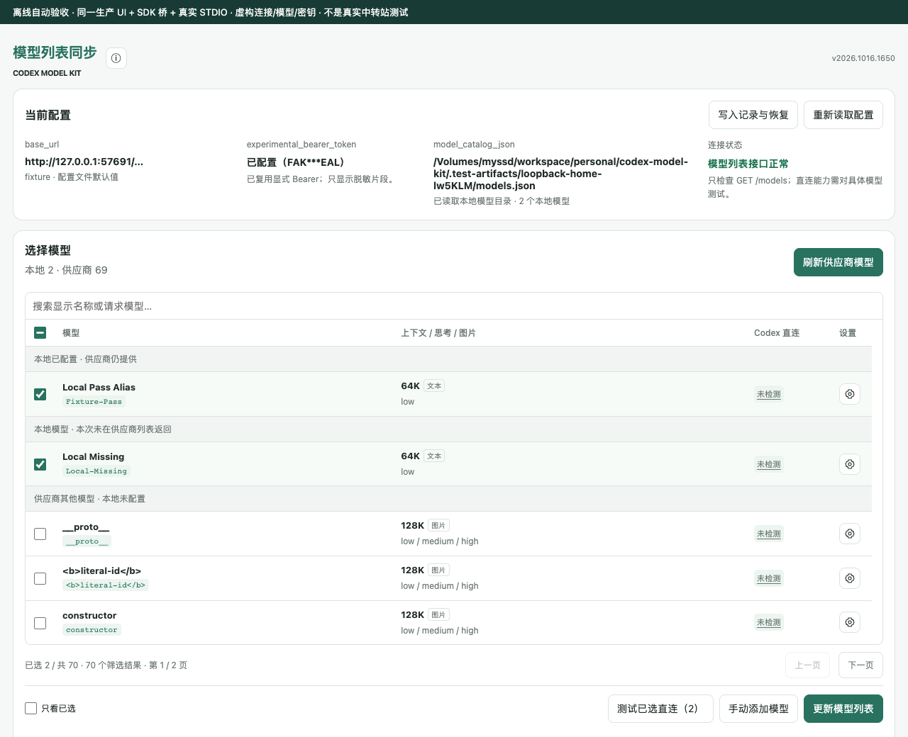
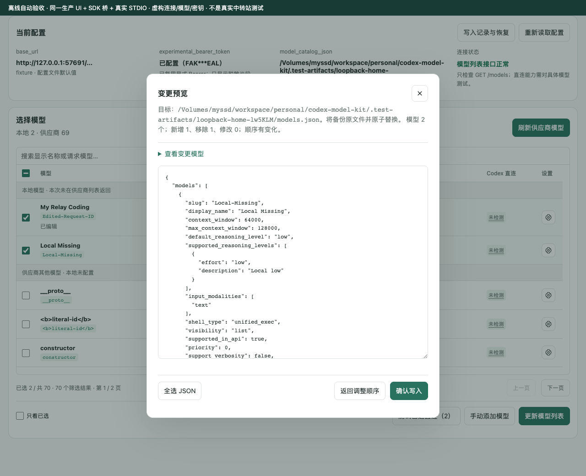

# Codex Model Kit

[简体中文](README.md) | [English](README.en.md)

Refresh provider models, edit parameters, and reorder the model menu inside Codex. Review and confirm changes before syncing them to your local model catalog.

**Manages only `model_catalog_json`. Does not change connection settings, credentials, or the active model.**

[Installation and Updates](#installation-updates-and-uninstallation) · [Usage Guide (Chinese)](docs/usage.md) · [Latest Release](https://github.com/buzulabee/codex-model-kit/releases/latest) · [Validation Record (Chinese)](ACCEPTANCE.md)



> Screenshots show the current UI in an offline test with fictional connections, models, and credentials. They do not demonstrate a real provider connection or native Codex host validation. The plugin UI is currently in Simplified Chinese.

## Installation, Updates, and Uninstallation

Open Codex on the computer where you want to install the plugin and send:

```text
Install or update this plugin by following its README: https://github.com/buzulabee/codex-model-kit
```

Requires an available Node >=24 runtime and a native Codex CLI with plugin commands. Prefer the runtime supplied by the client; do not install Node automatically. **Use the same prompt to update an existing installation.**

### Instructions for the Installing Agent

1. Read [INSTALL.md (Chinese)](INSTALL.md) on the default branch and follow its installation or update procedure. An existing installation is not a reason to skip the version check.
2. Download the matching ZIP and SHA256 file from the [latest official Release](https://github.com/buzulabee/codex-model-kit/releases/latest). Verify the release notes, checksum file, and actual ZIP digest agree. Source versions do not imply publication. Do not use the Source code ZIP, clone the source, or run npm to install the plugin.
3. Use the current user's `CODEX_HOME/marketplaces/codex-model-kit` (default: `~/.codex/marketplaces/codex-model-kit`). Run the packaged installer's check before installation. Register through the official CLI only; do not edit managed caches, connection settings, credentials, or model catalogs manually.
4. Verify the installed/enabled version reported by the CLI and report the target path and result. Ask the user to open the plugin in a **new conversation** and check the version in the upper-right corner. If the native host has not been checked, state that UI validation is pending.

Stop and report the specific reason if no official Release is available, access is denied, the runtime is missing, or installation fails. Do not invent an alternative manual installation procedure. Full commands, recovery guidance, and uninstallation steps are in [INSTALL.md (Chinese)](INSTALL.md).

## Usage

1. Open the plugin from the Codex sidebar and inspect the existing configuration.
2. Refresh provider models (**刷新供应商模型**) and select the models to keep. Edit parameters using each row's settings or add models manually.
3. Update the model list (**更新模型列表**), resolve unknown parameters, and adjust the order. Preview changes (**预览变更**) before confirming a write.
4. Restart Codex after writing or restoring the catalog so the model menu and ordering take effect. Backups are available under write history and restore (**写入记录与恢复**).

<details>
<summary>View the write preview</summary>



Previewing or closing the dialog does not write files. The plugin checks for conflicts and backs up the original file before a confirmed write.

</details>

Direct connection checks are optional, require separate confirmation, send requests to the provider, and consume tokens. A successful check proves only that the basic text-stream test succeeded, not that every model capability works. See the [usage guide (Chinese)](docs/usage.md) for parameter rules, backup and restore behavior, and safety boundaries.

## Development

Requires Node >=24 and `zip`. Run in the source checkout:

```sh
npm ci
npm run check
npm run release:package
```

[Development and Release Checklist (Chinese)](docs/development.md) · [CI and Publishing (Chinese)](CI.md) · [Windows Support Boundaries (Chinese)](WINDOWS.md)

`.claude-plugin/marketplace.json` is the compatibility marketplace manifest used by the Codex installation flow, not an unused Claude plugin directory. Building, version synchronization, and installation checks depend on it.

## License

This project is licensed under the [MIT License](LICENSE). Use, modification, distribution, and commercial use are permitted provided the copyright and permission notices are retained. The software is provided as is, without warranty.

Third-party dependencies and reference data remain subject to their respective licenses. Their notices are retained in `marketplace/plugins/codex-model-kit/THIRD_PARTY_LICENSES.txt` in the distribution. The new project license will be included in the next versioned release package; existing release assets are not replaced.
